# AWS Serverless File Processing System

An event-driven serverless file processing system built using **Amazon S3, AWS Lambda (Python), IAM, and Amazon CloudWatch**.

The system automatically detects files uploaded to an S3 input bucket, invokes a Lambda function, extracts file metadata, generates a JSON file, and stores the generated metadata in a separate S3 output bucket.

## Project Overview

| Attribute | Details |
|---|---|
| Project Name | AWS Serverless File Processing System |
| Cloud Provider | Amazon Web Services (AWS) |
| Architecture | Event-Driven Serverless Architecture |
| Programming Language | Python |
| Storage | Amazon S3 |
| Compute | AWS Lambda |
| Security | AWS IAM |
| Monitoring | Amazon CloudWatch |
| AWS Region | Asia Pacific (Mumbai) – `ap-south-1` |

## Project Objectives

- Automate file processing using AWS serverless services.
- Trigger Lambda automatically whenever a file is uploaded to S3.
- Extract file metadata such as filename, file size, and extension.
- Generate structured JSON metadata.
- Store generated JSON files in a separate S3 bucket.
- Implement IAM permissions following the principle of least privilege.
- Monitor Lambda execution using CloudWatch Logs.

## Architecture Diagram

The project follows an event-driven architecture where Amazon S3 automatically invokes AWS Lambda when a new file is uploaded.

View the project architecture in [Architecture Diagram](architecture/aws-serverless-architecture.png).

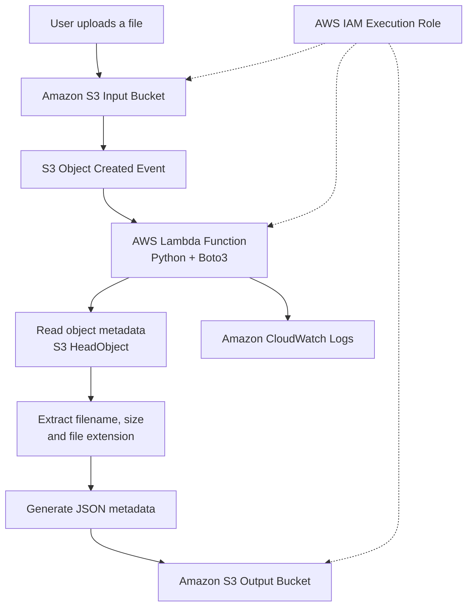

### Workflow Explanation

1. A user uploads a file to the input S3 bucket.
2. Amazon S3 generates an Object Created event.
3. The event automatically triggers the Lambda function.
4. Lambda retrieves the uploaded file's metadata using the S3 `HeadObject` API.
5. Python extracts the filename, file size, and file extension.
6. The function generates a JSON metadata file.
7. The generated JSON file is stored in the output S3 bucket.
8. Execution details and errors are recorded in CloudWatch Logs.

## AWS Services Used

| AWS Service | Purpose |
|---|---|
| Amazon S3 | Stores uploaded files and generated JSON metadata |
| AWS Lambda | Executes the Python file-processing logic |
| AWS IAM | Controls permissions between AWS services |
| Amazon CloudWatch | Stores Lambda execution logs |

## AWS Resource Configuration

### 1. Amazon S3 Buckets

Two separate S3 buckets are used.

**Input Bucket**

`ayush-file-processing-input-2026`

Purpose:
- Stores uploaded files.
- Generates Object Created events.
- Acts as the source of file-processing requests.

**Output Bucket**

`ayush-file-processing-metadata-2026`

Purpose:
- Stores generated JSON metadata.
- Maintains structured information about processed files.

Both buckets are configured in the Mumbai AWS Region (`ap-south-1`) with Block Public Access enabled.

### 2. AWS Lambda Function

Function Name: `S3FileProcessingFunction`

Configuration:
- Runtime: Python 3.15
- Architecture: x86_64
- Trigger: Amazon S3
- Execution Role: `Lambda-S3-FileProcessing-Role`

The Lambda function processes uploaded files automatically without requiring a continuously running server.

### 3. IAM Execution Role

Role Name: `Lambda-S3-FileProcessing-Role`

Attached permissions:

**AWSLambdaBasicExecutionRole**

Allows Lambda to write execution logs to Amazon CloudWatch.

**S3FileProcessingPolicy**

A custom inline policy that provides:
- `s3:GetObject` access to the input bucket.
- `s3:PutObject` access to the output bucket.

The permissions are restricted to the respective bucket objects instead of granting unrestricted S3 access.

### 4. S3 Event Trigger

The S3 event notification is configured with:

| Configuration | Value |
|---|---|
| Event Source | Amazon S3 |
| Input Bucket | `ayush-file-processing-input-2026` |
| Event Type | All Object Create Events |
| Prefix | None |
| Suffix | None |
| Destination | `S3FileProcessingFunction` |

The trigger automatically invokes Lambda whenever a new object is created in the input bucket.

The output bucket is not connected to the same trigger, preventing recursive processing of generated JSON files.

## Python Implementation

The Lambda function uses Python and Boto3 to retrieve object metadata and generate JSON output.

**Main operations:**

- `boto3.client('s3')` – Initializes the S3 client.
- `head_object()` – Retrieves object metadata.
- `os.path.splitext()` – Extracts the file extension.
- `json.dumps()` – Converts metadata into JSON.
- `put_object()` – Uploads the generated JSON file to the output bucket.
- `print()` – Records execution information in CloudWatch Logs.

Supported file extensions:

`.pdf`, `.txt`, `.csv`, `.jpg`, `.png`

Files with other extensions are marked as `Invalid File Type`.

The function extracts S3 object metadata; it does not read or extract the actual text or content inside uploaded documents.

See the implementation in [`lambda/lambda_function.py`](lambda/lambda_function.py).

## IAM Security Policy

The custom IAM inline policy follows least-privilege access for the two S3 buckets.

See [`iam/s3-lambda-policy.json`](iam/s3-lambda-policy.json).

Required actions:

| IAM Action | Resource | Purpose |
|---|---|---|
| `s3:GetObject` | Input bucket objects | Read object metadata |
| `s3:PutObject` | Output bucket objects | Save generated JSON |

CloudWatch logging permissions are provided separately by `AWSLambdaBasicExecutionRole`.

## Project Screenshots

The following screenshots document the actual AWS implementation.

### 1. S3 Bucket Configuration

**Input S3 Bucket**

Stores files uploaded for processing.

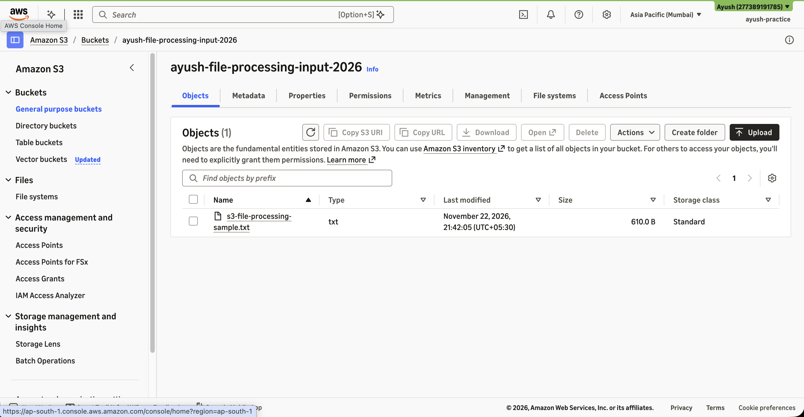

**Output S3 Bucket**

Stores generated JSON metadata.

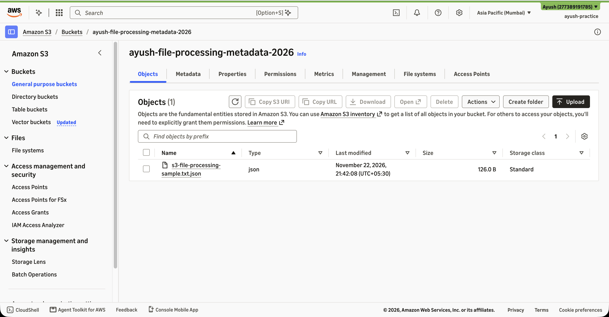

### 2. IAM Configuration

**Lambda Execution Role**

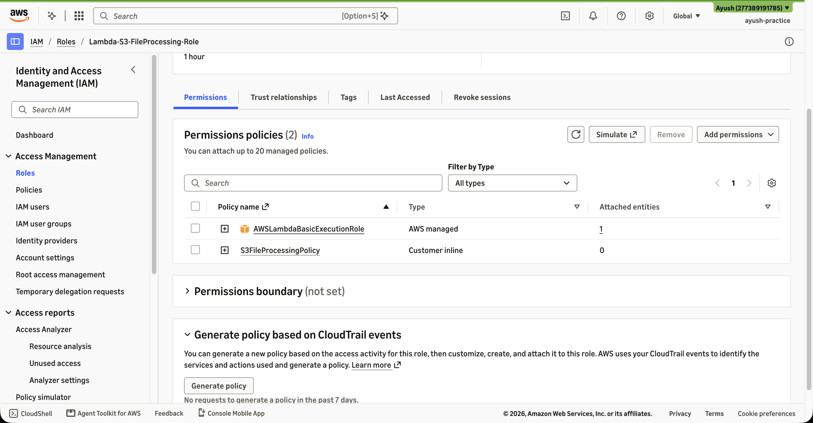

**Custom S3 Inline Policy**

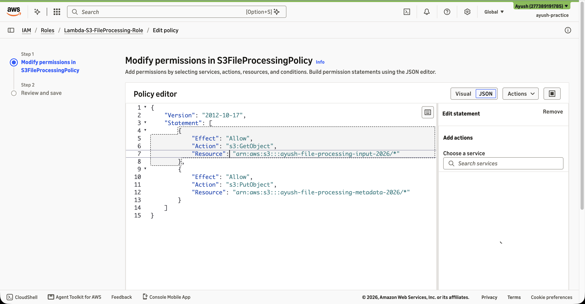

### 3. AWS Lambda Configuration

**Lambda Function Created**

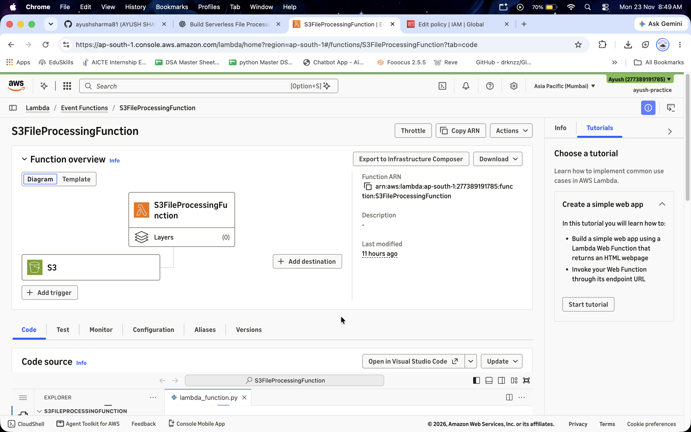

**Python Implementation**

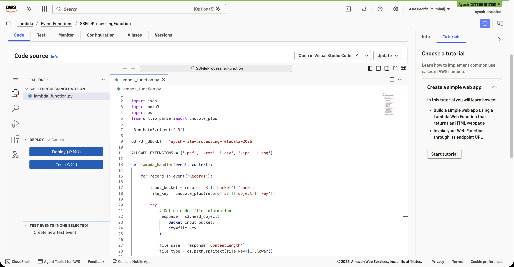

### 4. S3 Event Trigger

The input bucket is connected to the Lambda function through an S3 Object Created event notification.

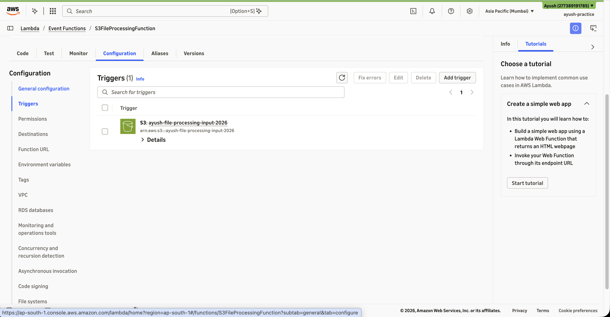

### 5. File Upload and Processing

**Uploaded Sample File**

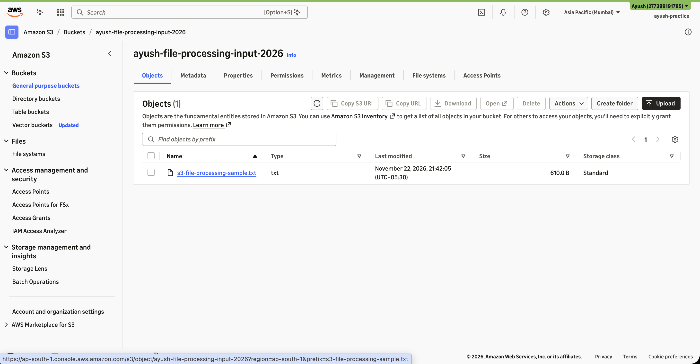

**Lambda Execution**

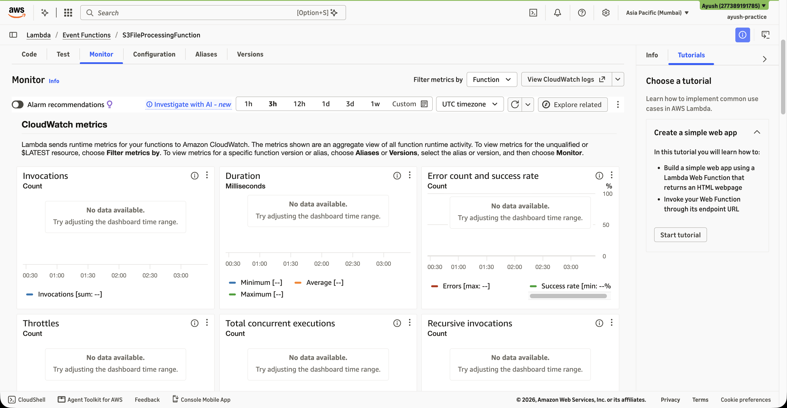

**CloudWatch Logs**

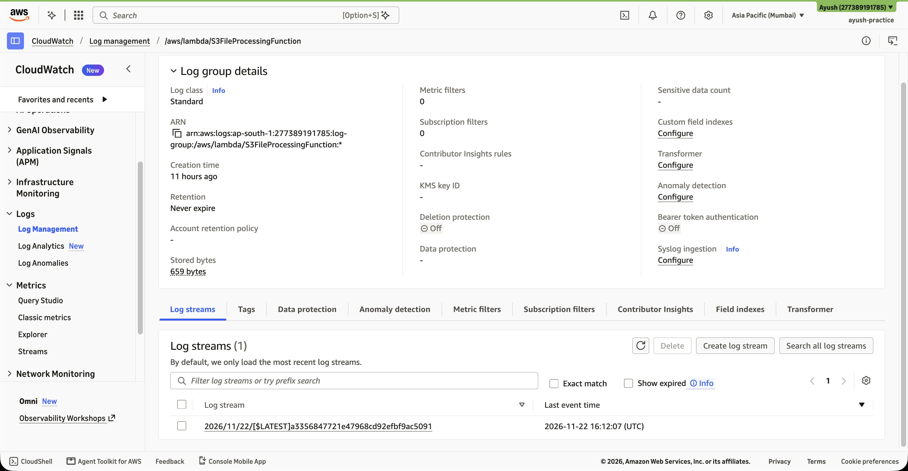

### 6. Generated JSON Output

The Lambda function successfully generated the following metadata:

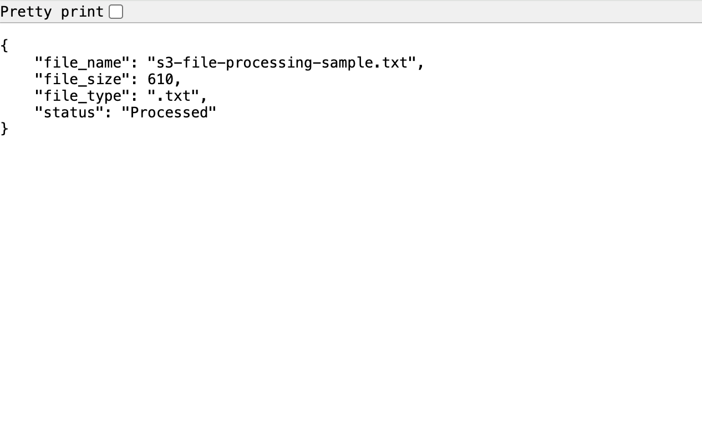

## Testing and Results

A sample text file was uploaded to the input S3 bucket.

**Input File**

`s3-file-processing-sample.txt`

**Generated Output**

`s3-file-processing-sample.txt.json`

**JSON Output:**

```json
{
    "file_name": "s3-file-processing-sample.txt",
    "file_size": 610,
    "file_type": ".txt",
    "status": "Processed"
}
```

**Test Results**

| Test Case | Expected Result | Status |
|---|---|---|
| Upload TXT file | Lambda gets triggered | Passed |
| Retrieve file metadata | Filename and size extracted | Passed |
| Identify file extension | `.txt` detected | Passed |
| Generate JSON metadata | JSON object created | Passed |
| Upload JSON to output bucket | JSON stored successfully | Passed |

The successful test confirms that the S3-to-Lambda-to-S3 workflow is functioning as expected.

## Key Learning Outcomes

Through this project, I gained practical experience with:

- Building event-driven serverless architectures on AWS.
- Configuring Amazon S3 event notifications.
- Developing AWS Lambda functions using Python and Boto3.
- Creating and managing IAM execution roles.
- Implementing resource-specific S3 permissions.
- Generating and storing structured JSON metadata.
- Monitoring serverless executions through CloudWatch Logs.
- Testing and troubleshooting AWS service integrations.

## Future Improvements

- Add file size validation.
- Implement duplicate file detection.
- Store processing timestamps in JSON metadata.
- Add SNS notifications for processing failures.
- Introduce retry handling and a dead-letter queue.
- Add automated deployment using AWS SAM or Terraform.

## AWS Cost Management

This project uses serverless AWS services and does not require continuously running EC2 instances.

AWS charges may still apply for S3 storage, requests, Lambda usage, and CloudWatch logging depending on usage and applicable free-tier or credit allowances.

After testing, unused resources can be deleted to prevent ongoing storage and monitoring costs.

## Author

**Ayush Sharma**

B.Tech Computer Science and Engineering | AWS Certified

- GitHub: [github.com/ayushsharma81](https://github.com/ayushsharma81)
- LinkedIn: [linkedin.com/in/ayushsharma81](https://linkedin.com/in/ayushsharma81)

---

If you find this project useful, feel free to explore the repository and learn more about AWS serverless architecture.
